<p align="center">
  <a href="https://github.com/moradzadeh67/credo">
    
  </a>
</p>

<p align="center">
  <a href="https://github.com/moradzadeh67/credo/releases/latest">
    
  </a>
  <a href="https://opensource.org/licenses/MIT">
    
  </a>
  <a href="https://flutter.dev">
    
  </a>
  <a href="https://flutter.dev">
    
  </a>
  <a href="https://dart.dev">
    
  </a>
  <a href="https://github.com/moradzadeh67/credo/actions/workflows/ci.yml">
    
  </a>
  <a href="https://moradzadeh67.github.io/credo/app/">
    
  </a>
</p>

<p align="center">
  <a href="https://github.com/moradzadeh67/credo/releases/latest"><b>📥 Download APK</b></a> •
  <a href="https://moradzadeh67.github.io/credo/app/"><b>🌐 Live Web Demo</b></a> •
  <a href="#-features"><b>✨ Features</b></a> •
  <a href="#-architecture"><b>🏗️ Architecture</b></a> •
  <a href="#-installation--running"><b>🚀 Getting Started</b></a> •
  <a href="#-troubleshooting--faq"><b>❓ FAQ</b></a>
</p>

---

## 🌍 What is Credo?

**Credo** is a **free, open-source** Flutter app for people who build with **OpenRouter**. It keeps your
API key and shows your credit situation in real time — without opening the web dashboard.

It runs on **Android, iOS, macOS and the web**, stores your key in the platform's secure vault, and talks
to nothing but the OpenRouter API you configure.

- ✅ **100% free** — no accounts, no ads, no telemetry, no backend
- ✅ **MIT licensed** — read it, fork it, ship it
- ✅ **Keys stay on your device** — macOS/iOS Keychain, Android Keystore (never a plain file)
- ✅ **Four platforms, one codebase** — Material 3, dark / light / system

## 💡 Why I Built This

As a developer frequently building with LLMs via OpenRouter, I found myself constantly navigating to the web dashboard just to check my remaining credits and monitor usage limits. I wanted a fast, lightweight, and secure tool that lived on my desktop and mobile devices without requiring third-party servers or exposing my API keys. Since I couldn't find a focused, privacy-first utility that fit my workflow, I decided to build Credo.

## 🎬 Demo

<p align="center">
  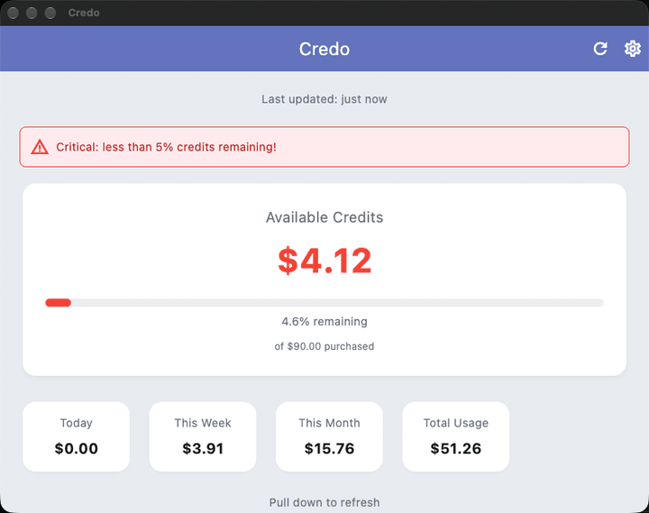
</p>

A quick tour: the credit dashboard with balance, usage and burn rate; the low-balance warning; switching
between light and dark themes; and the settings screen where the key lives.

## 📸 Screenshots

### macOS
| Home | Dark Mode | Settings |
|:---:|:---:|:---:|
| 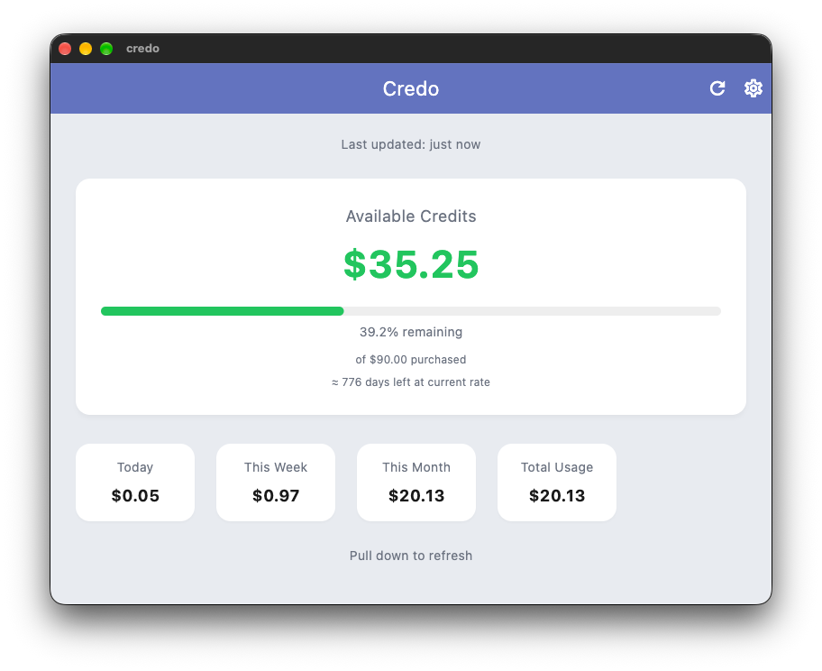 | 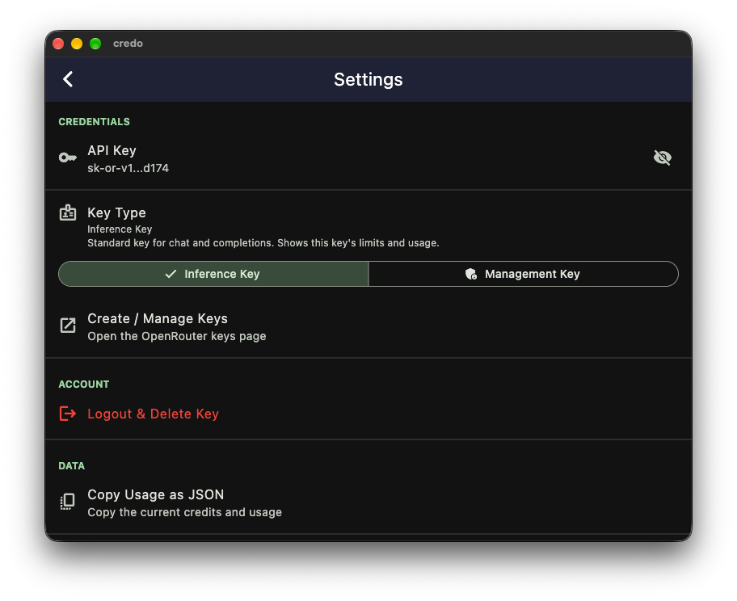 | 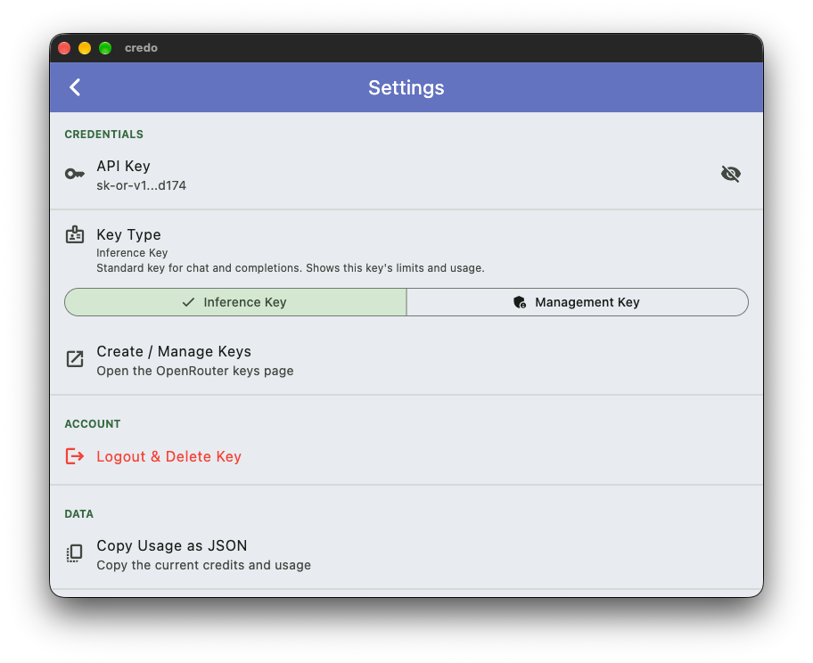 |

### Android
| Home | Dark Mode | Settings |
|:---:|:---:|:---:|
| 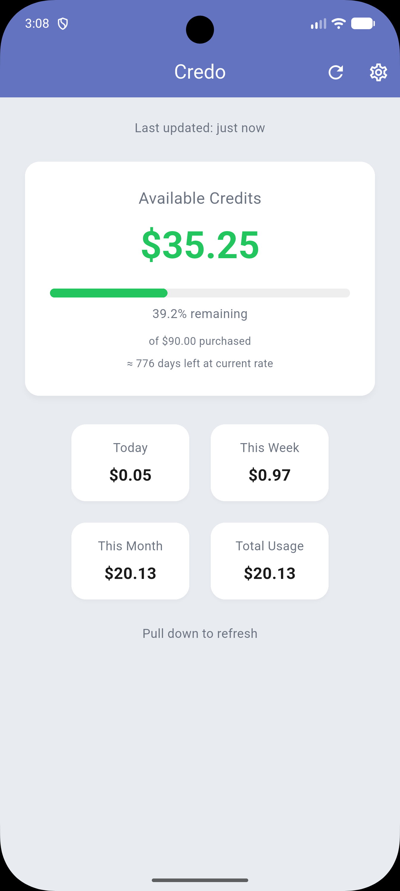 | 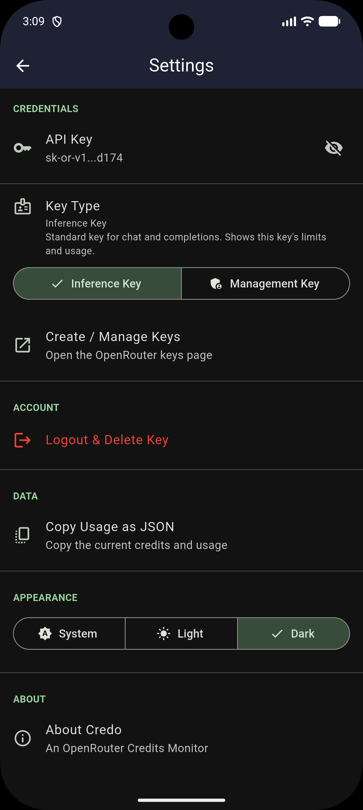 | 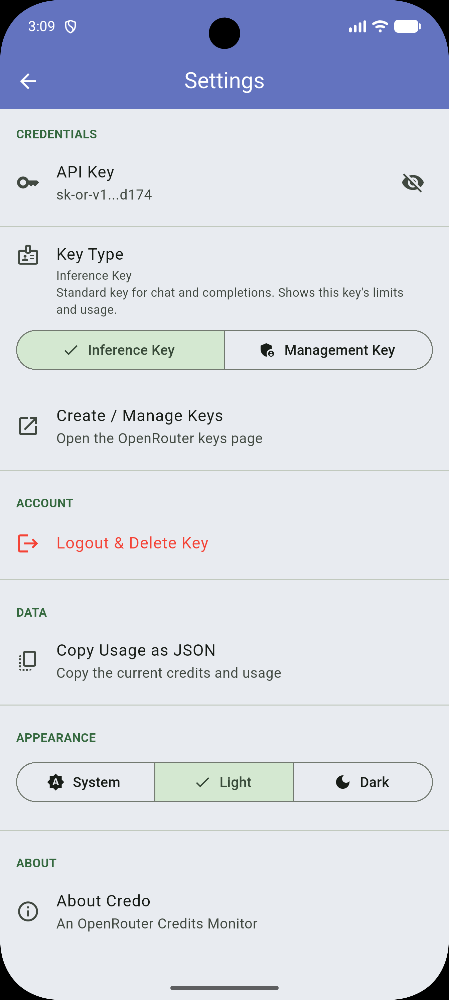 |

### iOS
| Home | Dark Mode | Settings |
|:---:|:---:|:---:|
| 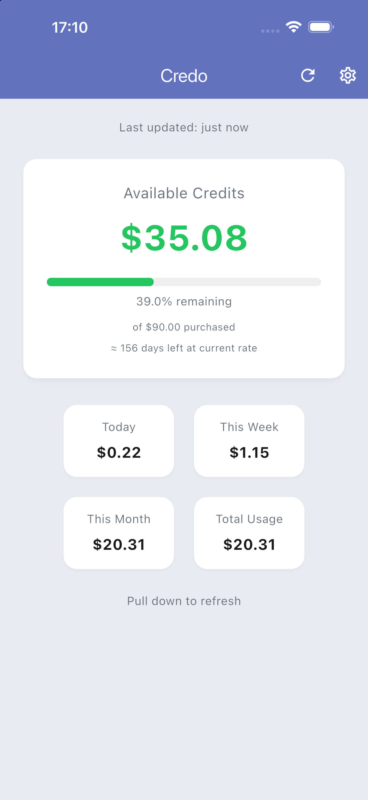 | 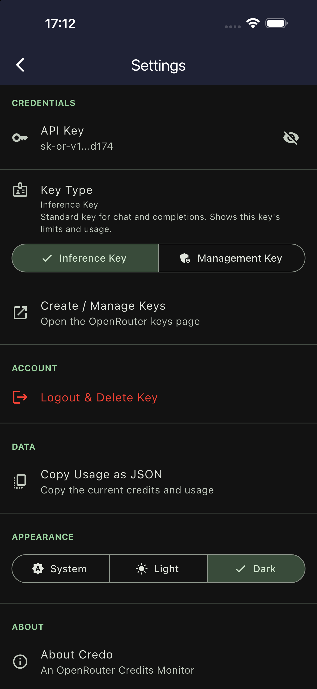 | 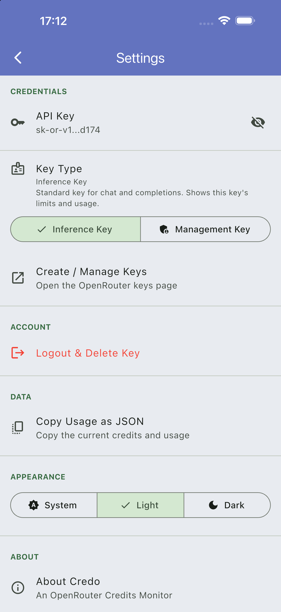 |

### Web
| Home | Dark Mode | Settings |
|:---:|:---:|:---:|
| 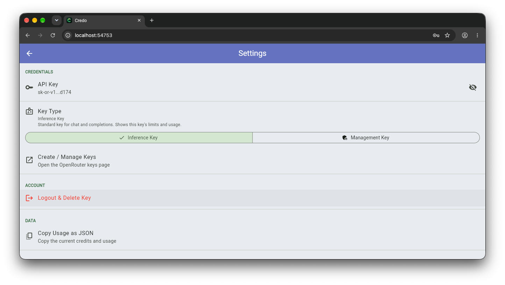 | 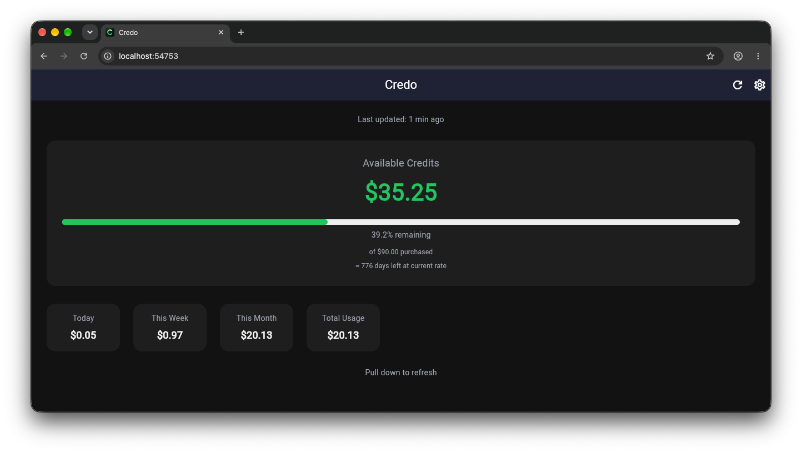 | 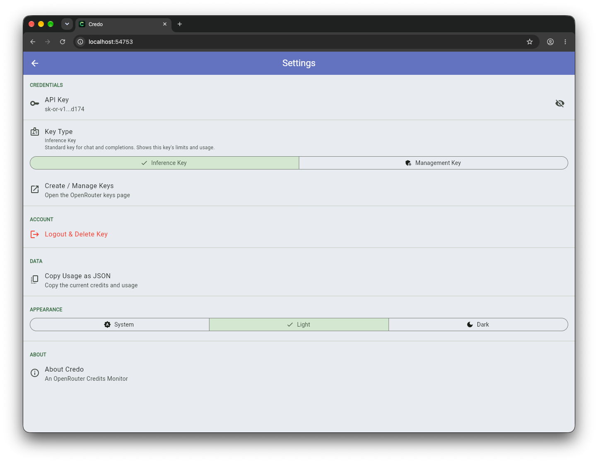 |

> 💡 **Note:** Screenshots live in `assets/screenshots/`, organised by platform.

## ✨ Features

- 🔐 **Secure API Key Storage** — Keys are encrypted in system-native storage (Keychain on iOS/macOS, Keystore on Android).
- 💳 **Real-Time Credit Monitoring** — Instant overview of remaining credits and total account balance.
- 📊 **Usage Tracking** — Detailed breakdowns for daily, weekly, monthly, and total API usage.
- 📈 **Burn Rate Estimation** — Smart calculation showing estimated days remaining based on current usage velocity.
- 🔔 **Low-Balance Alerts** — Visual warning banners when credit drops below custom threshold percentages (20% and 5%).
- 🌗 **Dark / Light / System Theme** — Full Material 3 theming support that respects system preferences or user choice.
- 🎨 **Centralized Theme System** — All colors, elevation, and typography defined in a single `AppTheme` class for consistent UI across every screen and platform.
- 📋 **Export to JSON** — One-tap backup and export of credit snapshots and key metadata.
- 📱 **Multi-Platform** — Native responsive support for Android, iOS, macOS, and Web.

## 🌐 Localization & Language Support

The interface ships in **English** today, with the text layer prepared for translation (`intl` is already
a dependency) and the app's typography built on Material 3's scalable text theme.

- **Currently:** English UI.
- **Roadmap:** Persian (Farsi) as the first additional language, then further locales — see [Roadmap](#-roadmap).

## 🗺️ Roadmap

- [x] Secure API key storage (Keychain / Keystore)
- [x] Credit balance & usage monitoring
- [x] Dark / Light / System theme modes
- [x] Centralized theme system (`AppTheme`)
- [x] Low-balance warning alerts
- [x] Burn-rate estimation
- [x] JSON data export
- [x] Signed Android releases + web build on GitHub Pages
- [ ] Persian (Farsi) localization, then more languages
- [ ] Multiple API key profiles support
- [ ] Historical usage graphs & analytics
- [ ] Desktop system tray / menu bar quick indicator
- [ ] Push notifications for critical credit thresholds

## 🛠️ Technical Decisions

Every technical choice in Credo was made with simplicity, maintainability, and security in mind:

- **Provider (State Management)**: Chosen over BLoC or Riverpod because Credo is a focused, single-purpose application. Provider provides a lightweight, idiomatic `ChangeNotifier` solution without introducing unnecessary boilerplate or complex event streams.
- **`flutter_secure_storage`**: API keys are high-value credentials. Storing them in standard `SharedPreferences` or local JSON files is insecure. `flutter_secure_storage` delegates storage directly to platform-native secure vaults (iOS/macOS Keychain, Android Keystore).
- **`http` over `dio`**: Credo only communicates with two simple REST endpoints (`/api/v1/key` and `/api/v1/credits`). Using standard `http` keeps the dependency footprint minimal without needing Dio's complex interceptor architecture.
- **Material Design 3**: Provides modern UI components, adaptive layout scaling, and dynamic dark/light color palette integration out of the box.
- **Centralized Theme (`AppTheme`)**: All colors, elevation values, and text styles are defined in a single `lib/theme/app_theme.dart` file. This ensures visual consistency across every screen and platform, and makes future theme adjustments a one-file change.
- **Directory Structure (`models/` - `services/` - `screens/` - `providers/` - `theme/` - `utils/`)**: Enforces clean separation of concerns. Data models, network/storage services, UI screens, theme constants, and state logic remain strictly decoupled for readability and testability.

## 📦 Key Dependencies

| Package | Version | Purpose |
|---|:---:|---|
| `provider` | `^6.1.1` | Lightweight `ChangeNotifier` state management for the app's single store |
| `flutter_secure_storage` | `^11.1.1` | Encrypted key storage in the macOS/iOS Keychain and the Android Keystore |
| `http` | `^1.1.0` | Minimal HTTP client for the two OpenRouter REST endpoints |
| `intl` | `^0.19.0` | Number/currency and date formatting (and the base for future localization) |
| `url_launcher` | `^6.3.1` | Opening OpenRouter pages safely in the native browser / custom tab |
| `flutter_launcher_icons` | `^0.14.4` | Build-time generation of the platform launcher icons (dev dependency) |

> 💡 **Note:** Versions are the constraints declared in `pubspec.yaml`. Resolved versions when this release shipped (`pubspec.lock`): `provider` 6.1.5+1, `flutter_secure_storage` 11.1.1, `http` 1.6.0, `path_provider` 2.1.6, `web` 1.1.1.

## 🏗️ Architecture

Credo follows a clean layered architecture using the Provider pattern.

### Project Structure

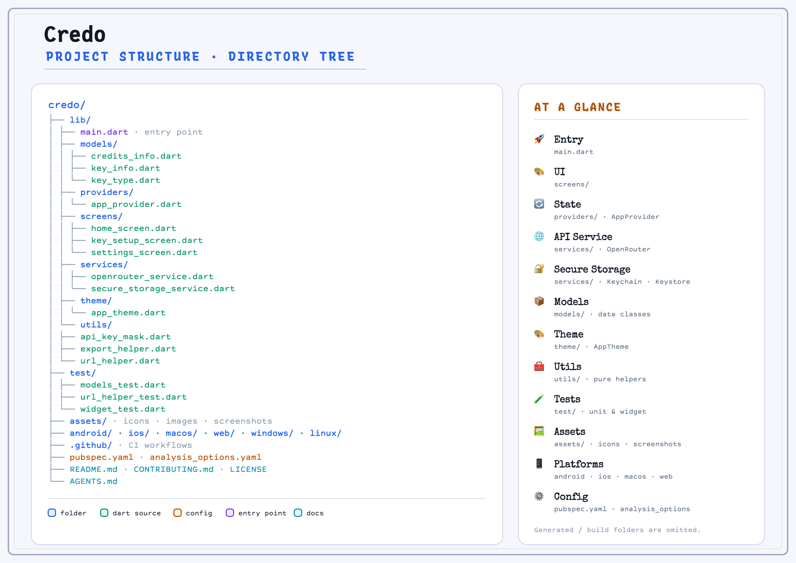

### Architecture Layers

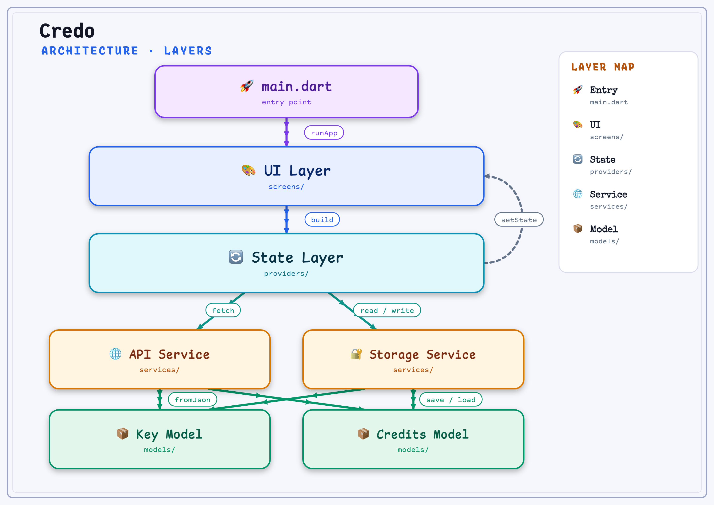

### Data Flow

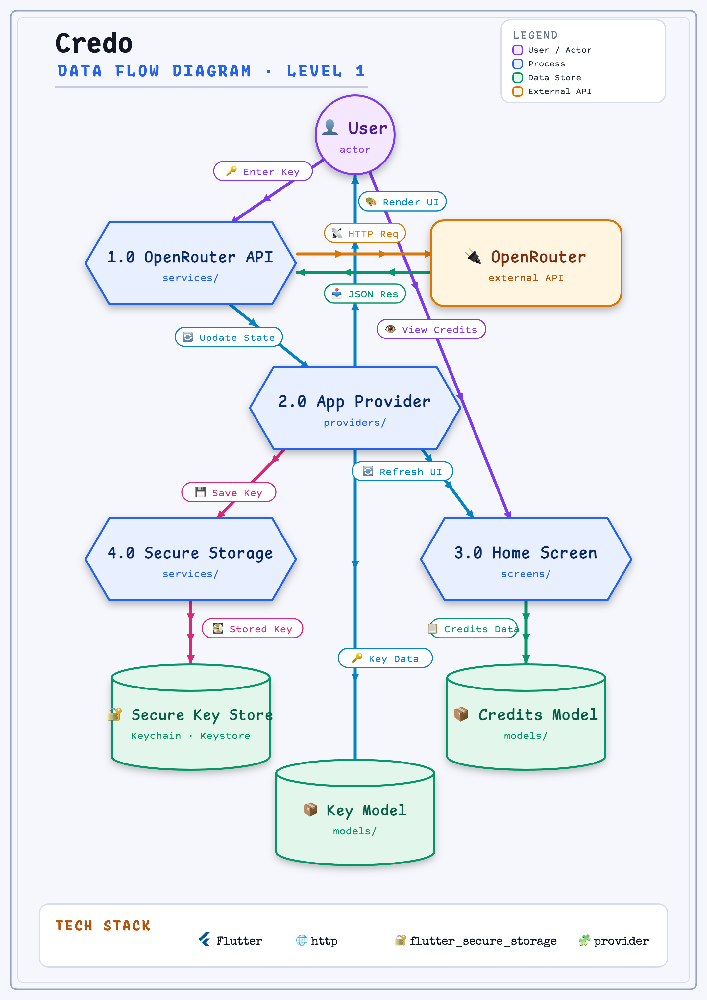

### Layer Overview

```
lib/
├── models/     → Data models (CreditsInfo, KeyInfo, KeyType)
├── providers/  → State management & business logic (AppProvider)
├── screens/    → UI presentation layer (Home, KeySetup, Settings)
├── services/   → External APIs & native storage (OpenRouter, SecureStorage)
├── theme/      → Centralized theme (AppTheme — colors, elevation, typography)
└── utils/      → Pure helper functions (mask, url, export)
```

### Data Flow Summary

1. **Entry** — `main.dart` calls `runApp()`
2. **UI Layer** — `screens/` builds widgets
3. **State Layer** — `providers/` manages app state (Provider pattern)
4. **Services** — `services/` handles API calls and secure storage
5. **Models** — `models/` represents typed data
6. **Update Cycle** — State changes trigger `notifyListeners()` → UI rebuilds

More detail: [docs/ARCHITECTURE.md](docs/ARCHITECTURE.md).

## 📱 Platform Support

| Platform | Status | Notes |
|---|:---:|---|
| 🤖 Android | ✅ Tested | Working on phones & tablets; signed APK on the [Releases page](https://github.com/moradzadeh67/credo/releases/latest) |
| 🍎 iOS | ✅ Tested | Working on iPhone & iPad |
| 🌐 Web | ✅ Tested | Chrome, Firefox, Safari compatible — try the [live demo](https://moradzadeh67.github.io/credo/app/) |
| 🖥️ macOS | ✅ Tested | Apple Silicon |
| 🪟 Windows | ⚠️ Untested | Build available |
| 🐧 Linux | ⚠️ Untested | Build available |

## 🔒 Privacy & Security

> [!IMPORTANT]
> - **Your key stays local.** It is stored in the macOS/iOS Keychain or the Android Keystore — never in a plain file and never in this repository.
> - **One destination.** Credo talks only to the OpenRouter API you configure (`/api/v1/key`, `/api/v1/credits`) over HTTPS.
> - **No tracking.** No backend, no proxy, no analytics, no crash reporting, no accounts.
> - **Web build caveat.** In the browser the key is kept in browser storage (WebCrypto-encrypted), which is weaker than a hardware-backed vault — prefer the native builds on your own machines.

Details: [docs/PRIVACY.md](docs/PRIVACY.md).

## 🚀 Installation & Running

> [!NOTE]
> The **web app** is already live at <https://moradzadeh67.github.io/credo/app/> and the signed Android
> APK is on the [Releases page](https://github.com/moradzadeh67/credo/releases/latest). macOS and iOS are
> built from source with the steps below.

### 🔑 Getting Your API Key

1. **Sign up / Log in**: Go to [OpenRouter](https://openrouter.ai/).
2. **Navigate to API Keys**: Access your account's [API Keys settings](https://openrouter.ai/keys).
3. **Create a Key**: Generate a new API key (choose either an *Inference* or *Management* key).
4. **Copy the Key**: Copy the generated key string and paste it into Credo when prompted during setup.

### Prerequisites

- [Flutter SDK](https://docs.flutter.dev/get-started/install) (v3.47.2)
- Dart SDK (^3.13.2)
- Platform-specific:
  - **Android**: Android Studio / Android SDK 24+ (`minSdk 24`)
  - **iOS / macOS**: Xcode 15+ (development used Xcode 27.0)
  - **Web**: any modern browser

### Getting Started

1. **Clone the repository**:
   ```bash
   git clone https://github.com/moradzadeh67/credo.git
   cd credo
   ```

2. **Install dependencies**:
   ```bash
   flutter pub get
   ```

3. **Run the application**:
   ```bash
   flutter run -d macos
   flutter run -d <android-device-id>
   flutter run -d chrome
   ```

### Building

```bash
# Signed Android APK (see Release Signing below)
flutter build apk --release

# macOS desktop app
flutter build macos --release

# Web bundle (the Pages site uses --base-href /credo/app/)
flutter build web --release
```

## 🧪 Testing & Quality Assurance

The suite runs fully offline — no network, no real API keys.

```bash
# Analyze code for errors and lint compliance (must report zero issues)
flutter analyze

# Run unit and widget tests (9 passing tests)
flutter test
```

## 🔐 Release Signing

Android release builds are signed with the project's **upload key** (`Credo-upload.jks`, alias `credo`).
The keystore lives **outside** this repository; its credentials are read from `android/key.properties`,
which is git-ignored and never committed.

```properties
# android/key.properties — NEVER commit this file
storePassword=YOUR_STORE_PASSWORD_HERE
keyPassword=YOUR_KEY_PASSWORD_HERE
keyAlias=credo
storeFile=/absolute/path/to/your/upload-keystore.jks
```

Create your own upload key with `keytool`:

```bash
keytool -genkeypair -v \
  -keystore ~/keystores/credo.jks \
  -storetype PKCS12 -keyalg RSA -keysize 2048 -validity 10000 \
  -alias credo \
  -dname "CN=your-name, OU=Mobile, O=Credo, C=IR"
```

Then build and verify:

```bash
flutter build appbundle --release   # → build/app/outputs/bundle/release/app-release.aab
flutter build apk --release         # → build/app/outputs/flutter-apk/app-release.apk

$ANDROID_HOME/build-tools/<version>/apksigner verify --print-certs \
  build/app/outputs/flutter-apk/app-release.apk
```

> [!NOTE]
> If `android/key.properties` is missing — on a fresh clone, for example — Gradle automatically falls
> back to the debug signing key. The build never breaks; it simply is not signed with the release key.

> [!CAUTION]
> Back up your keystore and its passwords somewhere safe. If the upload key is lost you can no longer
> publish updates for `com.moradzadeh67.credo`.

## 🔄 CI/CD

| Workflow | Trigger | What it does |
|---|---|---|
| [`ci.yml`](.github/workflows/ci.yml) | push & PR to `master` | Runs `flutter analyze` and `flutter test` on Flutter 3.47.2 |
| [`deploy-web.yml`](.github/workflows/deploy-web.yml) | push to `master` | Builds the web app, assembles the landing page + app into the Pages site and deploys it |

**Published site:** <https://moradzadeh67.github.io/credo/> — landing at `/`, the Flutter web app at `/app/`.

> [!NOTE]
> No secrets live in this repository: `android/key.properties`, `*.jks` and `*.keystore` are all ignored
> by Git, and no API key is required to build or test the app.

## ⚠️ Known Limitations

- **Web storage:** in the browser the key is kept in browser storage, not a hardware-backed vault — use the native builds for real work.
- **iOS:** there is no signed/TestFlight distribution yet; iOS is currently build-from-source.
- **macOS:** the app is not notarized, so Gatekeeper warns on first launch of a locally built bundle.
- **Windows / Linux:** build folders exist but the platforms are untested.
- **App id change:** the Android app id moved to `com.moradzadeh67.credo`; installs of the old `com.example.credo` build are a separate app (uninstall them, and re-enter your key).

## ❓ Troubleshooting & FAQ

<details>
<summary><b>1. Is my API key safe?</b></summary>

Yes. It is stored in the macOS/iOS Keychain or the Android Keystore and is only ever sent to the
OpenRouter API over HTTPS. Nothing goes to the author or any other third party. See
[docs/PRIVACY.md](docs/PRIVACY.md).
</details>

<details>
<summary><b>2. Which key type should I create — Inference or Management?</b></summary>

Credo only reads your key's metadata and credit balance, so either type works for viewing. Create an
**Inference** key if you also call models with it; a **Management** key if you only want account
overview. You can keep both and switch.
</details>

<details>
<summary><b>3. Why do I have to enter my key again after updating?</b></summary>

The Android app id changed from `com.example.credo` to `com.moradzadeh67.credo`, and the macOS bundle id
changed with it. Android and the Keychain treat those as a different app, so the stored key is not
carried over — enter it once in the new build. (Old installs can be uninstalled.)
</details>

<details>
<summary><b>4. Does the web build store my key as safely as the desktop app?</b></summary>

No. In a browser the key is encrypted with WebCrypto and kept in browser storage, which is weaker than
the Keychain / Keystore. Use the web build to look around; use a native build for your real key.
</details>

<details>
<summary><b>5. The balance shows zero or an error — what now?</b></summary>

Check that the key is valid and has not been revoked in your [OpenRouter dashboard](https://openrouter.ai/keys),
then tap refresh. If the error persists, open an issue with the message you see (never paste the key).
</details>

## 💻 Development Environment

This project is actively developed and tested using:
- **Hardware**: MacBook Pro (Apple M3 Pro, 18 GB)
- **OS**: macOS 27.0.1
- **IDE**: VS Code / Android Studio
- **Xcode**: 27.0
- **Flutter**: 3.47.2 • channel stable
- **Dart**: 3.13.2

## 📋 Requirements

- Flutter SDK: 3.47.2
- Dart SDK: ^3.13.2
- Android: SDK 24+ (`minSdk 24`)
- iOS: built with Xcode 15+
- macOS: built with Xcode 15+
- Web: any modern browser

## 🙏 Credits & Attribution

Built with ❤️ using [Flutter](https://flutter.dev), powered by the [OpenRouter API](https://openrouter.ai/), and supported by open-source packages including [Provider](https://pub.dev/packages/provider) and [flutter_secure_storage](https://pub.dev/packages/flutter_secure_storage).

## 🤝 Contributing

Contributions are welcome! Please read [CONTRIBUTING.md](CONTRIBUTING.md) for guidelines on how to get started.

## 📄 License

This project is licensed under the MIT License — see the [LICENSE](LICENSE) file for details.

Copyright © 2026 Mohammadreza Moradzadeh ([@moradzadeh67](https://github.com/moradzadeh67))
